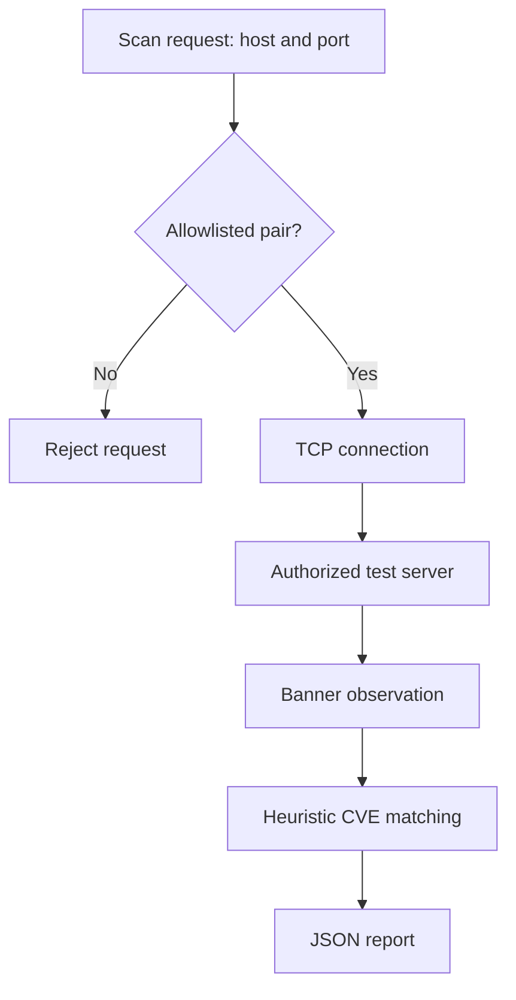

# VulnAware

AI-driven 24/7 vulnerability scanning, risk prioritization, and remediation
automation for modern enterprise security teams and DevSecOps pipelines.

---

## What VulnAware does

VulnAware keeps running so your team doesn't have to keep watching. A
continuously-running discovery loop profiles your domains, subdomains,
certificates, and exposed services; credentialed scanners reach across your
internal network; cross-account cloud connectors inventory your AWS, Azure,
and GCP posture; and an application-layer engine runs DAST against your live
services. Every finding is normalized into the same exploitability-ranked
queue — so the team works one backlog whether the next item came from the
perimeter, a misconfigured IAM role, or a transitive npm dependency.

The risk-scoring pipeline runs **live**, not just on a scheduled cadence:
external exploit telemetry (CISA KEV, FIRST EPSS, VulnCheck) is polled
continuously, and a finding's priority score is re-derived as soon as one
of those feeds confirms active exploitation — see
[Threat intelligence + scoring override](#threat-intelligence--scoring-override).

Six coverage surfaces, all wired into the ranked-queue backend:

- **External surface** — Continuous internet-wide exposure monitoring for
  your domains, subdomains, certificates, and exposed services.
- **Internal network** — Authenticated, protocol-depth scanning across
  VLANs and cloud networks (agentless and credentialed).
- **Cloud & SaaS** — Cross-account posture review against CIS benchmarks
  with identity, network, and data-plane drift detection across AWS, Azure,
  GCP, and the SaaS stack.
- **Software supply** — SCA + SBOM for direct, transitive, and
  developer-introduced dependencies, with CVE feed matching and downstream
  SBOM export.
- **Application layer** — DAST + targeted dynamic testing tuned to your
  framework and stack.
- **Compliance** — Framework-mapped control rollups and audit-trail export
  for SOC 2, ISO 27001, HIPAA, and PCI.

A host:port scanner ships alongside the cloud asset-discovery connectors so
you can point VulnAware at any reachable target from the web UI.

---

## AWS asset discovery — customer setup

VulnAware inventories your AWS account by **assuming a cross-account IAM
role that you create and control**. The platform never sees long-lived IAM
user keys — every run is a fresh STS `AssumeRole` session.

### What you create in your AWS account

1. **IAM role** (in the customer AWS account) granting read-only access to
   what you want enumerated. Concretely:
   - Trust policy: `sts:AssumeRole` from the VulnAware deploy account
     (your VulnAware operator provides the exact principal ARN and any
     other conditions you require), gated by **the `ExternalId` you
     choose**.
   - Managed policies: `ReadOnlyAccess` (or a tighter equivalent — VPC list,
     EC2 describe, S3 list, IAM read, Resource Explorer read, Config
     read) are sufficient.
2. **External ID** (a UUID you generate). You paste it into the VulnAware
   connection form; it must match the role's trust policy.
3. **Role ARN** of the form
   `arn:aws:iam::<your-account-id>:role/<role-name>`. Paste the role's
   ARN and the external ID into the connection form.

### What you paste into `/cloud`

The AWS section of the cloud page accepts a connection per target account:

| Field | What it is |
| --- | --- |
| `label` | Display name for the connection in the dashboard. |
| `roleArn` | The cross-account IAM role ARN (see above). |
| `externalId` | Your chosen external ID; must match the role's trust policy. |
| `regions` | One or more AWS regions to enumerate. |

VulnAware stores only the role ARN and external ID — no AWS keys, ever. To
revoke access, delete the role in your AWS account (or the connection row
on `/cloud`).

### Reference

- `POST /api/aws/connections` (session-authed, owner-scoped via
  `requireAuth()` and `where: { userId }`).
- `src/lib/business/scanner/aws-discovery/sts-assume.ts` (STS wrapper that
  reads the platform's deploy credentials from env).

### Posture

VulnAware does **not** hold long-lived customer AWS credentials. The
`AWS_REGION` env var sets the default STS region only; per-connection
regions live in the DB. If you set `AWS_REGION`, leave it at the default
unless you have a concrete reason to override it.

---

## Azure asset discovery — customer setup

VulnAware inventories your Azure tenant by **holding a service-principal
client secret per connection**. Each discovery run mints a fresh OAuth2
token; removing a connection immediately revokes the ability to mint new
tokens.

### What you create in your Azure tenant

1. **App registration** in your tenant's Microsoft Entra ID.
2. **Service principal** for that app registration, with the **Reader**
   role assignment on the subscription(s) you want enumerated.
3. **Client secret** for the app registration (treat this as a secret —
   rotate via Entra ID when it expires).
4. **Tenant ID** and **Client ID** of the app registration, plus the
   **Subscription ID**(s) and the geographic **locations** to enumerate.

### What you paste into `/cloud`

The Azure section of `/cloud` collects, per connection:

| Field | What it is |
| --- | --- |
| `label` | Display name for the connection. |
| `tenantId` | Microsoft Entra tenant (directory) ID. |
| `clientId` | App registration / service principal client ID. |
| `clientSecret` | Service principal client secret (stored per row). |
| `subscriptionId` | Azure subscription ID to enumerate. |
| `locations` | One or more Azure regions. |

### Revocation

Removing a connection row on `/cloud` (or rotating the client secret in
Entra ID) is sufficient to revoke access. There is no long-lived platform
identity for Azure — the secret is per-connection, so revocation is a
single delete.

### Reference

- `POST /api/azure/connections` (session-authed, owner-scoped).
- `POST /api/azure/discover`, `GET /api/azure/discover/[id]`
  (probe + status of queued discovery runs).
- `jobs/azure-discovery-runner.ts` (cron-drained runner; uses
  `@azure/identity` + `@azure/arm-*`).

### Optional deploy-side env (fallback identity)

If you want the connection-test probe to use a platform-managed identity
for fallback testing, set both:

```
AZURE_TENANT_ID=
AZURE_CLIENT_ID=
```

with no `AZURE_CLIENT_SECRET` (use the managed-identity flow); per-row
customer credentials always win over the fallback.

---

## GCP asset discovery — customer setup

VulnAware inventories your GCP project by **storing a full service-account
JSON per connection**. Each discovery run mints a fresh OAuth2 token from
that JSON; removing a connection immediately revokes the ability to mint
new tokens.

### What you create in your GCP project

1. **Service account** dedicated to VulnAware.
2. **Grant** the IAM `roles/viewer` role on the project(s) you want
   enumerated (read-only is sufficient — VulnAware does not mutate your
   GCP resources).
3. **Create and download a JSON key** for the service account. Paste the
   full JSON into the VulnAware connection form.

### What you paste into `/cloud`

The GCP section of `/cloud` collects, per connection:

| Field | What it is |
| --- | --- |
| `label` | Display name for the connection in the dashboard. |
| `projectId` | GCP project ID to enumerate. |
| `serviceAccountJson` | Full downloaded service-account JSON key (stored per row). |

### Revocation

Removing a connection on `/cloud` revokes the stored JSON. To revoke
immediately on Google's side, delete the service account key from the GCP
IAM console as well — VulnAware cannot mint tokens against a key that no
longer exists.

### Reference

- `POST /api/gcp/connections` (session-authed, owner-scoped).
- `POST /api/gcp/discover`, `GET /api/gcp/discover/[id]`.
- `jobs/gcp-discovery-runner.ts` (cron-drained runner; uses
  `google-auth-library` + `@google-cloud/*`).

### Optional deploy-side env

For federated workload-identity (no per-connection JSON), set the project
fallback:

```
GCP_PROJECT_FALLBACK=
```

If unset, customers must supply a per-connection service-account JSON.

---

## API key model

Enterprise consumers (SIEMs, ticketing systems, dashboards) authenticate to
`/api/v1/**` with a **scoped API key** sent via the `x-api-key` request
header. There is exactly one secret format; the plaintext is returned to
you **exactly once** at creation and never persisted (only an scrypt
hash). Rotation = create a new key + revoke the old one.

### Scopes

| Scope | What it can do | Use it for |
| --- | --- | --- |
| `team` | List and read **every scan owned by the team**. Per-scan reads work for any scan on the team. | Production integrations; dashboards; SIEM ingestion. |
| `scan` | Only trigger and read the **single** scan whose id matches the key's bound `scanId`. Cannot list scans. | One-off / single-scan integrations; least-privilege sharing. |

### Endpoints

| Method / Path | Required scope | Notes |
| --- | --- | --- |
| `GET /api/v1/scans` | team | List scans for the caller's team. Scan-scoped keys are rejected with `403 forbidden_scope`. |
| `GET /api/v1/scans/[id]/findings` | team **or** scan | Findings for a single scan — see 403 model below. |
| `POST /api/v1/webhooks/trigger` | team | Trigger a new scan. Scan-scoped keys are rejected with `405 scope_not_supported` (the scan doesn't exist yet, so there is no `scanId` to bind). Wrong verbs on this path return `405 method_not_allowed` with `Allow: POST`. |
| `POST /api/v1/keys` | **admin only** (better-auth session, role `admin`) | Create a new API key; plaintext returned in the response **exactly once**. |
| `GET /api/v1/keys` | admin | List keys for the caller's team (the `system` team is seeded for admins). |
| `DELETE /api/v1/keys/[id]` | admin | Revoke a key — the row's `revokedAt` is set and the key is no longer accepted. |

### 403 model — `GET /api/v1/scans/[id]/findings`

Existence is **never leaked**: once a key is authenticated but
unauthorized, you always get a `403`, never a `404`. Codes come back
verbatim in the `error` field of the JSON response:

| Status | `error` body | What it means |
| --- | --- | --- |
| `403` | `forbidden_other_team` | The key's team does not own this scan. The key is from a different team entirely; the caller's team cannot see this scan. |
| `403` | `forbidden_other_scan` | The key has scan scope and the requested scan id does not match the key's bound `scanId`. The key is from the right team but bound to a different scan. |
| `403` | `forbidden` | `POST /api/v1/keys` (or another admin endpoint) called without an admin session. |
| `405` | `method_not_allowed` | A scan-scoped key tried to call `GET /api/v1/scans` or `POST /api/v1/webhooks/trigger`. |

Use these codes verbatim in your SIEM / integration logic — they are the
public contract, not aspirational naming. A `403` from
`/api/v1/scans/[id]/findings` means **scope mismatch, not "wrong
credentials"**: the key authenticated fine, it just isn't authorized for
that scan.

### Bootstrap with `VULN_API_KEY`

Setting the deploy-time `VULN_API_KEY` env var bootstraps a `system`
team and a `team`-scoped default key under that team, so legacy CI/CD
callers can keep using a static shared secret. All keys created through
the admin surface (`POST /api/v1/keys`) flow through the same scrypt-hash
pipeline above.

---

## Host-side requirements

Operators deploying VulnAware must set the following env vars on the
**host** (the VulnAware deploy), **not** on customer accounts. Polsia
injects platform-managed values at deploy time — `./.env.example`
documents every var the app reads.

### Always required

| Var | Set by | Purpose |
| --- | --- | --- |
| `DATABASE_URL` | Polsia (`rdbms`) | Postgres connection string (SSL required). |
| `BETTER_AUTH_SECRET` | Operator | better-auth session signing secret (≥32 bytes of entropy recommended). |
| `BETTER_AUTH_URL` | Operator / Polsia | Public origin used for better-auth redirect URIs and cookie scope. |
| `NEXT_PUBLIC_APP_URL` | Polsia | The app's public origin; also the SEO absolute-URL base (`metadataBase`, canonical, robots, sitemap, Open Graph). |

### Required for AWS discovery to fire

```
# Host-side (VulnAware deploy) — required for AWS STS assume-role to fire
# when AwsDiscoveryRun runs the cron. Both are kept OUT of the customer
# connection row; they belong on the deploy. Never commit real values.
AWS_ACCESS_KEY_ID=
AWS_SECRET_ACCESS_KEY=
```

The platform's deploy IAM identity must have `sts:AssumeRole` permission
on each customer role's trust policy (with the customer-chosen
`ExternalId`).

### Optional

| Var | Effect when unset |
| --- | --- |
| `POLSIA_OWNER_EMAIL` | Admin bootstrap email (defaults to platform owner). |
| `NVD_API_KEY` | Falls back to NVD keyless rate limits (6 req / 30s). Set to elevate. |
| `VULN_API_KEY` | `/api/v1/**` fails closed with `503 api_key_not_configured`. |
| `AWS_REGION` | Defaults to `us-east-1`. |
| `AZURE_TENANT_ID` / `AZURE_CLIENT_ID` | Per-connection secrets win; fallback is unused. |
| `GCP_PROJECT_FALLBACK` | Customers must supply per-connection service-account JSON. |
| `SEO_INDEXABLE` | `robots.txt` returns `Disallow: /` — previews / staging / local are never indexed. Only set to `true` on the production deploy. |
| `NEXT_PUBLIC_API_URL` | Same-origin `/api`. Set only for an external API origin (token-ready mode). |
| `POLSIA_IMAGE_REMOTE_HOSTS` | No remote image hosts; `<Image>` cannot load third-party URLs. |
| `SKIP_ENV_VALIDATION` (build-time only) | Bypasses Zod env validation for envless builds (lint/CI/local). |

Treat every `*_SECRET`, `*_KEY` (non-NEXT_PUBLIC), and
`BETTER_AUTH_SECRET` as a secret. Never commit a real `.env` — the
`.gitignore` blocks every `.env*` pattern and the validator rejects any
tracked `.env*`.

---

## General setup / prerequisites

### Runtime

- **Node ≥ 20.18.1** (matches the pinned framework stack).
- npm 10+; the lockfile is committed. Do not yarn-install this codebase.
- Postgres 14+ reachable at `DATABASE_URL`. The deploy provisions it via
  the `rdbms` platform capability.

### Install / build / start

```bash
npm install --include=dev && npm run build
npx prisma db push --skip-generate --accept-data-loss
npm start
```

(That's exactly what `polsia.toml` declares; the build runs `next build`
under the devDependency toolchain, the start command materializes the
schema via `prisma db push` and then boots Next.)

### Healthcheck

The deploy readiness probe hits `GET /health` (`src/app/health/route.ts`).
If your probe is failing, the deploy is failing.

### End-user flow (the human's tour)

1. **Sign up** at `/signup` (better-auth email + password).
2. **Sign in** at `/login`.
3. **Land on `/cloud`**, choose a provider (AWS / Azure / GCP), and
   paste the credentials/Role ARN/JSON described in the section above.
4. **Kick off a discovery run** from the cloud card or open a host:port
   scan from `/scans`. The scheduled jobs drain queued discovery runs
   once a minute (see below).

### Local development without a DB

```bash
SKIP_ENV_VALIDATION=1 npm run dev
```

Type-check / lint / test do not need env:

```bash
npm run typecheck
npm run lint
npm run test
```

`/health` works without env. `/`, `/login`, `/signup` and any non-data
page work without a DB. Data pages (`/scans`, `/cloud`) are client-side
admin surfaces that hit `/api/*` (which itself needs env to talk to
Postgres).

For the separate, allowlisted local-only TCP research runner and Raspberry Pi
OS setup, see [Local TCP scan on Raspberry Pi OS](docs/local-scan.md). It does
not start the web app or change hosted scan restrictions.

---

## Scheduled jobs

Four crons in `polsia.toml`:

| Cron name | Drain table / behavior | SDK / client |
| --- | --- | --- |
| `aws-discovery-runner` | `AwsDiscoveryRun` | `@aws-sdk/{sts,ec2,s3,iam,config-service,resource-explorer-2}` |
| `azure-discovery-runner` | `AzureDiscoveryRun` | `@azure/{identity,arm-compute,arm-storage,arm-resources,arm-authorization}` |
| `gcp-discovery-runner` | `GcpDiscoveryRun` | `google-auth-library` + `@google-cloud/{compute,storage,resource-manager}` |
| `threat-intel-ingest` | Live re-score of every persisted `VulnerabilityFinding` | First.org EPSS + CISA KEV + VulnCheck NVD-CVE index (see below) |

The first three drain queued asset-discovery runs once a minute each. The
fourth re-derives KEV/EPSS/VulnCheck state every 15 minutes, gating each
feed on its own interval (KEV: 15m, EPSS: 1h, VulnCheck: 5m) so the
VulnCheck boost lands within five minutes of a fresh listing without
re-firing EPSS on the same tick. See the next section for how a bump
flips a finding's priority.

Each cron runs in a fresh checkout on the deploy — it pulls queued rows,
assumes the connection's identity, enumerates the requested regions /
subscriptions / projects, and writes back discovered assets / scores.
There are no in-process schedulers for product behavior; recurring work
goes through `polsia.toml`.

---

## Threat intelligence + scoring override

VulnAware's risk score is not just CVSS — three live external feeds feed
the formula and override the rank order whenever active exploitation
begins.

### Feeds

| Feed | Source URL | Cadence | Weight | What it boosts |
| --- | --- | --- | --- | --- |
| **CISA KEV** | `https://www.cisa.gov/sites/default/files/feeds/known_exploited_vulnerabilities.json` | 15 min | `+2.0` | Confirmed-exploited-in-the-wild. CISA curated, slower than VulnCheck to list. |
| **FIRST EPSS** | `https://api.first.org/data/v1/epss` | 1 hour | (probability bucket in `0..1`) | 30-day exploit-likelihood score; feeds the `0.4 * epss` term directly. |
| **VulnCheck NVD-CVE** | `https://api.vulncheck.com/v3/nvdcve` | 5 min | `+2.6` | Freshly-listed + in-the-wild exploitation signal. Outranks KEV on the comparator. |

### Formula

```
priorityScore = clamp(
  0.6 * cvss + 0.4 * epss
    + 2.0 * kevListed
    + 2.6 * vulncheckListed   # if epss >= 0.05, else 0
, 0..10)
```

The VulnCheck boost is **gated** by an EPSS floor (0.05) so a bare
listing on a CVE with no real-world signal does not flatline the
dashboard above genuinely dangerous CVSS-only findings. Without EPSS
signal, the boost collapses to zero.

### Comparator override

`src/lib/business/scanner/prioritize.ts` exports `compareFindings`, the
shared comparator used by every `/api/scan*` listing route and the
run-scan orchestrator. With the live-intel layer wired in, the
tiebreaker chain is:

1. `priorityScore` desc
2. `vulncheckListed` desc *(VulnCheck-listed outranks KEV-listed)*
3. `kevListed` desc
4. `cvssScore` desc
5. severity rank desc
6. `cveId` asc (stable tiebreaker)

So even at equal score, a freshly-listed VulnCheck hit hoists above a
hot KEV hit, which hoists above a CVSS-only finding.

### What triggers a re-rank

A finding's `priorityScore` is recomputed when any of the following
writes to the row:

- Initial scan completes (`rescoreSource = "scan"`).
- The `threat-intel-ingest` cron re-derives KEV/EPSS/VulnCheck for the
  row's `cveId` (`rescoreSource = "cron:kev" | "cron:epss" | "cron:vulncheck"`).
- A team member hits `POST /api/scan/[id]/rescore` for an on-demand
  refresh (`rescoreSource = "manual"`).

Every recompute that flips the score (or the KEV/VulnCheck bit) writes a
row to the `ThreatIntelEvent` audit table; `lastRescoreAt` records the
timestamp. A `VulncheckHit` row is appended-only every time VulnCheck
re-confirms a CVE the cron is watching — the append-only log makes
"when did this first trip?" trivially answerable.

### Cursor health

`GET /api/threat-intel/cursor` returns the per-feed `IntelFeedCursor`
row (last fetch / last success / last error / items seen). Use it to
surface "VulnCheck fetch failed" without grep'ing worker logs.

### Reference

- `src/lib/business/scanner/{kev,epss,vulncheck}.ts` — thin feed clients
  (best-effort, 5–10s deadline, retry-on-5xx, empty-map-on-failure).
- `src/lib/business/scanner/live-rescore.ts` — orchestrator. Pure
  function-style module: takes CVE ids, returns the diffed/bumped row
  set in one transaction.
- `jobs/threat-intel-ingest.ts` — cron drain loop; relative imports,
  per-feed error swallow.
- `src/app/api/scan/[id]/rescore/route.ts` — `POST`, team-scoped, on-
  demand.
- `src/app/api/threat-intel/cursor/route.ts` — `GET`, team-gated, cursor
  health.

### Required env

| Var | Effect when unset |
| --- | --- |
| `VULNCHECK_API_TOKEN` | VulnCheck client returns the empty map on every call; the cron still runs (it just stops bumping VulnCheck-listed findings). |
| `THREAT_INTEL_POLL_INTERVAL_MS` | Default 900 000 (15 minutes). |
| `THREAT_INTEL_EPSS_INTERVAL_MS` | Default 3 600 000 (1 hour). |
| `THREAT_INTEL_VULNCHECK_INTERVAL_MS` | Default 300 000 (5 minutes). |

---

## Security posture (restatement)

- **No long-lived customer credentials.** AWS uses STS AssumeRole with a
  customer-chosen external id; the platform's only AWS identity is its
  own deploy IAM identity. Azure and GCP store a per-connection credential
  scoped to the customer's app registration / service account — deleting
  the connection row (and rotating the credential at the provider)
  immediately revokes access.
- **Existence is not leaked.** An authenticated-but-unauthorized caller of
  `/api/v1/scans/[id]/findings` gets `403 forbidden_other_team` /
  `forbidden_other_scan`, never `404`. The codes are wire-format and
  stable.
- **API keys never store plaintext.** Only `scrypt(salt + plaintext)` is
  kept; the plaintext is returned exactly once on create. Revocation is
  per-row and the row stays in the DB with `revokedAt` set for audit.
- **Connection routes are owner-scoped.** Every read and mutation under
  `/api/{aws,azure,gcp}/connections` is filtered by `userId` via
  `requireAuth()`.

---

## Versions

Pinned exact versions are used for the framework stack:

- Next.js 16.2.6, App Router
- React 19.2.7
- Tailwind CSS 4.3.0, CSS-first `@theme`
- shadcn/ui New York style
- sonner 2.0.7
- TypeScript 5.5.4, strict mode
- Biome 2.3.1, lint and format
- Vitest 3.2.6
- Prisma 6.19.3
- Node >=20.18.1

Security `overrides` in `package.json` pin patched transitive dependency
versions that direct framework pins cannot reach on their own.

## License

MIT. See [LICENSE](./LICENSE).


---

## COMP 4721 Graduate Research Project

### Project Summary

VulnAware is an AI-assisted vulnerability scanning application developed using Polsia. This graduate research project evaluates its standalone TypeScript TCP scanner through controlled experiments in Kali Linux. The evaluation focuses on TCP port-state detection, passive service banner collection, heuristic CVE matching, authorization controls, and comparison with Nmap. The scanner identifies potential security concerns but does not independently verify vulnerabilities.

### Local Research Architecture



### Important Project Files

| File or Folder | Purpose |
| --- | --- |
| `src/` | Application source code and scanner components |
| `scripts/local-scan.ts` | Standalone scanning command |
| `scripts/local-scan-core.ts` | Local scan execution and authorization |
| `scripts/local-banner-server.ts` | Controlled TCP banner server |
| `scripts/local-scan.allowlist.json` | Authorized IP addresses and ports |
| `tests/` | Unit, integration, and application tests |
| `prisma/` | Database schema and migrations |
| `docs/local-scan.md` | Additional scanner instructions |
| `DEMO.md` | Test procedures and video demonstration |
| `AI_USAGE.md` | AI development disclosure |

### Evaluated Environment

- Windows host running VMware Workstation
- Kali Linux 2026.1 virtual machine
- Approximately 4 GB of VM memory
- Node.js 24.22.2
- npm 12.2.0
- Nmap 7.99
- TypeScript and Node.js
- Local loopback address: 127.0.0.1
- Authorized test port: 2222

### Installation

Clone the project:

```bash
git clone https://github.com/Gnutropic/Vulnaware.git
cd Vulnaware
npm ci --no-audit --no-fund
```

### Running the Scanner

Start the local test server in Terminal 1:

```bash
npx --no-install tsx scripts/local-banner-server.ts --host 127.0.0.1 --port 2222 --banner 'OpenSSL/1.0.1e'
```

Run the authorized scan in Terminal 2:

```bash
npx --no-install tsx scripts/local-scan.ts --host 127.0.0.1 --port 2222 --output ./local-scan-results/kali-loopback.json
```

View the results:

```bash
python3 -m json.tool ./local-scan-results/kali-loopback.json
```

### Evaluation Results

Five repeated authorized scans produced:

- VulnAware: 5/5 successful open-port detections
- Nmap: 5/5 successful open-port detections
- VulnAware: 154.2 ms average internal scan duration
- Nmap: 42.0 ms average reported scan duration

The timing measurements have different boundaries and should not be considered a direct speed comparison.

The scanner also rejected an unauthorized port and correctly reported the state of closed and silent TCP services.

### Known Limitations

- Banner matching does not verify actual vulnerabilities.
- The OpenSSL banner was simulated.
- The Heartbleed candidate was explicitly unverified.
- Silent services may be detected without identification.
- HTTP and TLS vulnerability verification were not demonstrated.
- Raspberry Pi ARM64 testing was not completed.

### Demonstration

See [DEMO.md](DEMO.md) for the recorded demonstration, exact commands, expected results, and instructions for reproducing the experiments.

### AI Usage

See [AI_USAGE.md](AI_USAGE.md) for details about the use of Polsia and ChatGPT.
